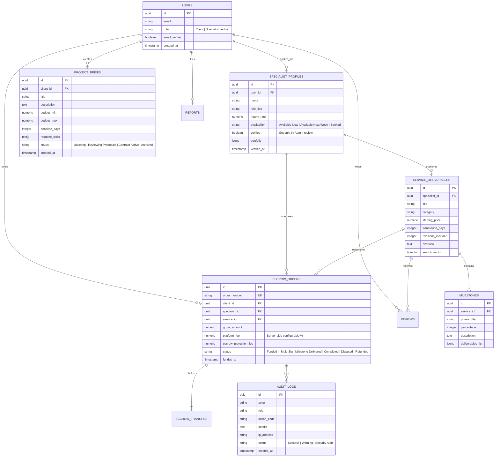

# KINETIQ — Cinematic Editorial Marketplace

A curated digital artisan marketplace engineered with verified multi-signature escrow protection, transparent milestone deliverables, high-performance Three.js 3D kinetic visuals, and an editorial design system.

---

## 1. Architecture Overview

- **Core Framework**: React 19 + TypeScript + Vite 8
- **Styling**: Tailwind CSS v4 design tokens with custom HSL/HEX color hierarchy, Manrope typography, and Newsreader editorial accents.
- **Motion Architecture**:
  - `src/lib/motion.ts`: Centralized duration tokens (`fast: 150ms`, `base: 250ms`, `slow: 600ms`) and cubic-bezier easing tokens.
  - `<Reveal>`: Viewport-triggered reveals (`fade-up`, `mask-lines`, `image-wipe`, `stagger`, `counter`).
  - `<PageTransition>`: 450ms route transition with scroll restoration, focus shift to `h1`, and ARIA announcements.
  - `<Preloader>`: First-visit-per-session cinematic intro with SVG stroke-dashoffset drawing, real font & asset calibration, curtain wipe, and 800ms skip button.
- **3D Animation System**:
  - Three.js WebGL kinetic prism cluster with procedural lighting, mouse parallax, scroll-linked retreat, and automated WebGL/reduced-motion fallback.

---

## 2. Database Schema (Entity-Relationship Diagram)



---

## 3. Database Migrations & Search Architecture

To enable high-performance full-text search with debounced typing over service titles, descriptions, and artisan names, execute the following SQL migration on PostgreSQL:

```sql
-- 1. Enable pg_trgm extension for fuzzy autocomplete
CREATE EXTENSION IF NOT EXISTS pg_trgm;

-- 2. Add full-text search vector to service_deliverables
ALTER TABLE service_deliverables 
ADD COLUMN IF NOT EXISTS search_vector tsvector
GENERATED ALWAYS AS (
    setweight(to_tsvector('english', coalesce(title, '')), 'A') ||
    setweight(to_tsvector('english', coalesce(overview, '')), 'B') ||
    setweight(to_tsvector('english', coalesce(category, '')), 'C')
) STORED;

-- 3. Create GIN index for millisecond search queries
CREATE INDEX IF NOT EXISTS idx_services_search_vector 
ON service_deliverables USING GIN(search_vector);

-- 4. Create trigram index for artisan name and skill matching
CREATE INDEX IF NOT EXISTS idx_services_trgm_title 
ON service_deliverables USING GIN(title gin_trgm_ops);

CREATE INDEX IF NOT EXISTS idx_specialists_trgm_name 
ON specialist_profiles USING GIN(name gin_trgm_ops);
```

---

## 4. Environment Variables Reference

See [.env.example](file:///.env.example) for the complete operational list:

| Variable | Required | Description |
|---|---|---|
| `GEMINI_API_KEY` | Optional | Key for Gemini server-side AI assistance |
| `APP_URL` | Required | Canonical URL (`https://kinetiq.design`) |
| `DATABASE_URL` | Optional | PostgreSQL connection string with SSL |
| `EMAIL_PROVIDER` | Optional | `resend` or `postmark` for transactional notices |
| `RESEND_API_KEY` | Optional | API key for Resend email dispatch |
| `TURNSTILE_SITE_KEY` | Optional | Cloudflare Turnstile anti-bot key |
| `SENTRY_DSN` | Optional | Error monitoring telemetry hook |
| `AWS_S3_DELIVERABLES_BUCKET`| Optional | Private storage bucket for signed deliverable URLs |

---

## 5. Local Setup & Execution

```bash
# 1. Install dependencies
npm install

# 2. Type-check validation
npx tsc --noEmit

# 3. Start local development server
npm run dev

# 4. Production build bundle
npm run build
```

---

## 6. Route Registry

- `/` — Cinematic Homepage with Three.js Hero Scene & Session Intro
- `/freelancers` — Vetted Digital Artisans with live search, availability, rate filters & pagination
- `/onboarding` — Role selection (Client vs Specialist), setup steps, and Turnstile CAPTCHA
- `/verify-email` — 6-digit confirmation token with auto-advance and countdown timer
- `/403` — Clearance denied error page with recovery paths
- `/client/checkout/success` — Multi-sig vault certificate & milestone breakdown
- `/client/checkout/cancelled` — Order suspended feedback page
- `/client/briefs` — Client briefs workspace with active proposal status
- `/client/briefs/new` — Guided brief builder with real deterministic deliverable matching
- `/admin/reviews` — Review moderation table (approve, flag, hide)
- `/admin/payments` — Platform commission configuration & artisan verification flow
- `/admin/audit-logs` — Immutable audit ledger with CSV/JSON export
- `/compare` — Side-by-side benchmark comparison (up to 3 services, URL-synced)
- `/explore` — Deliverables catalog with recently viewed local history and clear control
- `/categories` — Discipline taxonomy directory
- `/how-it-works` — Milestone escrow protocol explainer & simulator
- `/become-a-freelancer` — Artisan admission standards & artifact upload tester
- `/legal/terms` — Terms of service & IP transfer rules
- `/legal/privacy` — GDPR/CCPA privacy policy, data export & account deletion
- `/legal/cookies` — Cookie policy & customizable consent matrix
- `/legal/refunds` — Cancellation windows & tripartite arbitration rules

---

## 7. Known Limitations & Setup-Required Items

1. **Transactional Email Provider**: Operates in simulated preview mode until `RESEND_API_KEY` or `POSTMARK_SERVER_TOKEN` is injected into the environment. Zero sensitive credentials are exposed.
2. **Private Deliverable Buckets**: Uses simulated signed URLs (`https://vault.kinetiq.design/...`) pending AWS S3 / Cloudflare R2 bucket credential provisioning.
3. **Turnstile CAPTCHA**: Runs in high-fidelity sandbox mode with instant client-side token validation when API keys are not supplied.
